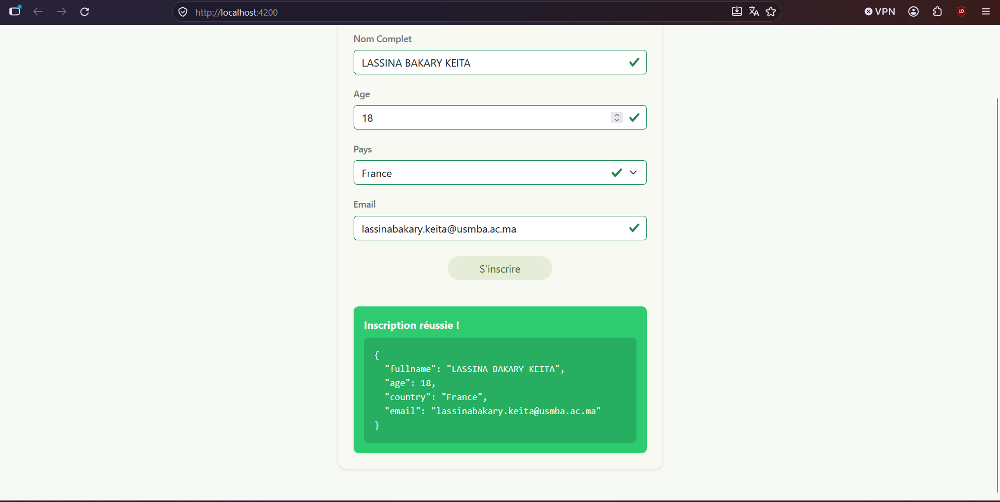

# InscriptionApp

Application front-end réalisée dans le cadre du **TP N°1 d'Angular (Formulaires)** à l'**ENSA de Fès** (encadré par le Prof. **Youness IDRISSI KHAMLICHI**). Ce projet, généré avec **Angular CLI version 22.2.4** et enrichi avec **Angular Material** (`@angular/material`), correspond à l'implémentation de l'**Exercice 1** dédié exclusivement aux **Template-Driven Forms**.

---

## État actuel du projet (Exercice 1)

Le projet implémente un formulaire d'inscription complet et fonctionnel basé sur l'approche **Template-Driven** d'Angular.

### Champs et règles de validation

* **Nom complet (`fullname`)** : champ obligatoire exigeant un minimum de 3 caractères.


* **Âge (`age`)** : champ obligatoire imposant un âge minimum de 18 ans.


* **Pays (`country`)** : liste déroulante obligatoire proposant plusieurs choix (dont France, Belgique, Suisse, Canada).


* **Email (`email`)** : champ obligatoire vérifiant la validité du format d'adresse électronique.


### Comportement et interface utilisateur

* **Validation en temps réel** : affichage de messages d'erreur clairs et visibles sous chaque champ dès que la saisie est invalide.


* **Sécurisation de la soumission** : le bouton **« S'inscrire »** reste automatiquement désactivé tant que l'ensemble des règles de validation du formulaire ne sont pas respectées.


* **Récapitulatif après validation** : une fois le formulaire valide et soumis, une bannière de confirmation (*« Inscription réussie ! »*) ainsi que l'objet JSON contenant les données saisies (`fullname`, `age`, `country`, `email`) s'affichent sous le formulaire.


---

## Stack technique

* **Framework** : Angular (CLI `22.2.4`)
* **Composants UI** : Angular Material (`ng add @angular/material`)


---

## Commandes de développement

### Serveur de développement

Pour lancer le serveur local, exécutez :

```bash
ng serve

```

Ouvrez ensuite votre navigateur à l'adresse `http://localhost:4200/`. L'application se rechargera automatiquement à chaque modification des fichiers sources.

### Génération de code

Pour générer un nouveau composant via Angular CLI :

```bash
ng generate component nom-du-composant

```

Pour consulter la liste complète des schémas disponibles (`components`, `directives`, `pipes`, etc.) :

```bash
ng generate --help

```

### Compilation (Build)

Pour compiler le projet :

```bash
ng build

```

Les fichiers compilés et optimisés pour la production sont générés dans le répertoire `dist/`.

## Demo 


---

## Ressources complémentaires

* [Documentation officielle Angular CLI](https://angular.dev/tools/cli)
* [Documentation Angular Material](https://material.angular.dev/)